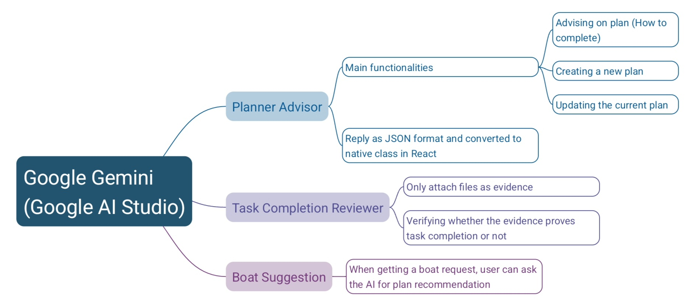
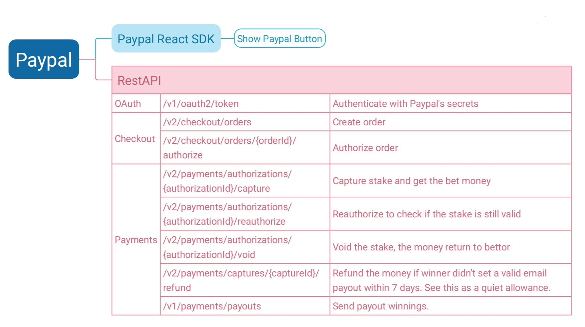

# [PayPal AI Hackathon 2026] Burn The Boat

[Check it out!](https://devpost.com/software/burn-the-boat)

Burn the Boat is an AI advising website that encourage disciplines by clear
goals management and money betting system.

React, TypeScript, Vite, and shadcn/ui app backed by Supabase (Auth, Postgres,
Realtime, Edge Functions) with PayPal-backed boat bets and Google's Gemini.

Demo website: https://burn-the-boat.onrender.com

**Privacy Notice:** When you log in to the demo website, your email address and
profile avatar are stored to run your account. Use a guest account to avoid
providing them. For more information, see [PRIVACY.md](./PRIVACY.md).

<div align="center">

<p><strong>AI Integration</strong></p>

<p><strong>PayPal Integration</strong></p>
</div>

## Setup

### 0. Prerequisites

Create accounts for these services:

- **Supabase:** Database, authentication, Edge Functions, and scheduled jobs.
- **Google AI Studio:** Gemini API access.
- **PayPal Developer:** PayPal-backed bets and payouts.

Sponsors services used:

- **AG Grid Community:** Displays transaction history.
- **Render:** Hosts the demo website.

### 1. Frontend `.env`

Copy `.env.example` to `.env` and fill in:

| Variable                 | Value                               |
| ------------------------ | ----------------------------------- |
| `VITE_SUPABASE_URL`      | `https://<project-ref>.supabase.co` |
| `VITE_SUPABASE_ANON_KEY` | Supabase publishable key            |
| `VITE_PAYPAL_CLIENT_ID`  | PayPal REST app client ID (public)  |

`VITE_*` values end up in the browser. Never put secrets in them.

### 2. Database

```bash
npx supabase link --project-ref <project-ref>
npx supabase db push --remote

# or `npx supabase db push` if using Docker
```

### 3. Supabase Auth settings (dashboard)

- Set the site URL and redirect URLs (local and deployed).
- Enable Google, anonymous sign-in, and **Manual Linking**.
- Optionally, configure email confirmation and SMTP.

### 4. Edge Function secrets

These are read by Edge Functions only. Your `.env` is not used on the server.

```bash
npx supabase secrets set \
  SERVICE_ROLE_KEY=<service-role-key> \
  PAYPAL_CLIENT_ID=<paypal-client-id> \
  PAYPAL_CLIENT_SECRET=<paypal-client-secret> \
  GEMINI_API_KEY=<new-gemini-api-key> \
  PAYPAL_ENV=sandbox
```

### 5. Deploy Edge Functions

```bash
npx supabase functions deploy delete-account
npx supabase functions deploy cleanup-inactive-guests
npx supabase functions deploy boat-stakes
npx supabase functions deploy settle-boat-stakes --no-verify-jwt
npx supabase functions deploy gemini
```

### 6. Vault secrets (for scheduled jobs)

The database cron jobs (daily guest cleanup at 03:00 UTC, boat settlement every
5 minutes) call Edge Functions and can only read Vault. Run this once in the
Supabase SQL Editor (never in a migration, the key would leak):

```sql
select vault.create_secret('https://<project-ref>.supabase.co', 'project_url');
select vault.create_secret('<SERVICE_ROLE_KEY>', 'service_role_key');
```

Update the Vault secret if you rotate the service role key. Note that
`db reset` wipes Vault, so add them again afterwards.

### 7. PayPal

Create a PayPal REST app (sandbox first) with **Payouts** enabled. Bets use
`AUTHORIZE`: nobody is charged unless they lose. Captures go to your merchant
account, then a PayPal Payout sends the winner's amount to their PayPal email.
A user who bets $0 types the email for their winnings in the boat's payment
panel.

An initiated payout does not guarantee delivery: PayPal may leave it pending,
unclaimed, or reject it. Check the individual payout status in PayPal before
attempting to send it again.

## Development

```bash
npm install
npm run dev
npm run build
npm run lint
```

### Notice

- Gemini requests require a signed-in account and are limited to 30 requests per
account per hour. Attachments are limited to 4 MB each and 6 MB per request.
- After both participants forfeit, the boat remains active until settlement
finishes; new requests for that pair are available afterward. Failed payouts
can delay settlement. The settlement run every 5 minutes.
- Accounts and pairings with unresolved boats or payments cannot be deleted;
inactive guest cleanup skips them until settlement finishes.
- Deadlines are capped at 29 days (PayPal authorization lifetime).
- Authorizations are guaranteed for 3 days. Longer boats are re-authorized once
  near the deadline, and bets on them are capped at $50.
- Free Supabase projects pause after a week of inactivity, which stops cron.
  Keep the project active (or use Pro) before using real money.

## Disclosure

Well frankly I vibe coded most of these. Typescript and everything here are new to me (I'm a Python dev anyway), I can take time and can build all of these anyway; but with the incoming deadline, I have to rely on Vscode Copilot. Well and I want to see what I can do with AI too, and its too fast...

So if you want to use this project for your service, please, please, and please, read the whole Supabase migrations again and check if anything leaks. Security is my worst thing here. I had proofread, but there might be error due to being vibed code. Please check the whole thing before giving to your customers.
